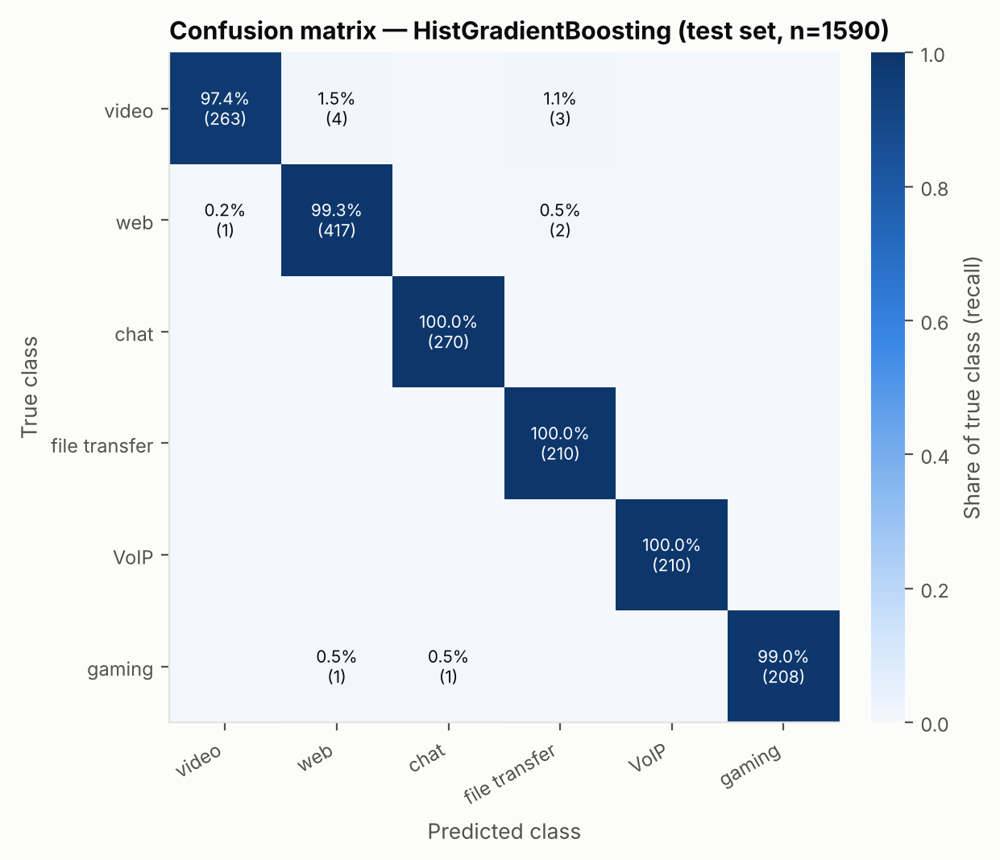

# Classifying Network Traffic Type from Encrypted-Flow Metadata

A self-contained research mini-project: can a passive observer tell **what kind of application** produced an encrypted network flow (video streaming, web browsing, chat, file transfer, VoIP, online gaming) using **only packet sizes, timing and direction**, without ever reading the payload? And what does it cost an endpoint to stop them?

The repository contains a documented synthetic traffic generator, a feature-extraction and model-training pipeline, the generated dataset, every result file and figure, and a paper ([`paper/paper.md`](paper/paper.md)) written from those results.

## Headline results

All numbers come from `results/` and are reproduced by one command (see below). Test set: 1,590 held-out flows.

| Model | Accuracy | Macro-precision | Macro-recall | Macro-F1 | 5-fold CV macro-F1 |
|---|---|---|---|---|---|
| Logistic regression | 0.9761 | 0.9784 | 0.9771 | 0.9777 | 0.9693 ± 0.0063 |
| Random forest | 0.9855 | 0.9865 | 0.9867 | 0.9866 | 0.9791 ± 0.0022 |
| **Hist. gradient boosting** (selected by CV) | **0.9925** | **0.9929** | **0.9929** | **0.9929** | **0.9885 ± 0.0038** |
| MLP (128-64) | 0.9862 | 0.9869 | 0.9877 | 0.9872 | 0.9859 ± 0.0031 |

* **Early classification:** 3 packets → 0.64 macro-F1, 20 packets → 0.91, full 60-s flow → 0.99.
* **Countermeasures (adaptive attacker that retrains on defended traffic):** padding every packet to the MTU costs +68% bytes and only lowers macro-F1 to 0.97. Constant-rate BuFLO-style shaping lowers it to 0.59, at the cost of +262% bytes and a median 66 ms of queueing delay per flow.
* **Domain shift:** a model trained on broadband traffic drops from 0.993 to 0.968 macro-F1 on cellular-like traffic. Adding cellular examples to training brings it back to 0.982.
* Most remaining errors come from sub-types that really are ambiguous: short-form or paused video, web pages with embedded video, and casual games that talk HTTPS.



## Quick start

```bash
python -m venv .venv && source .venv/bin/activate
pip install -r requirements.txt
python -m unittest discover tests        # 9 unit tests, ~3 s
python -m src.run_pipeline               # regenerate data + all experiments, ~3-4 min on 4 cores
python -m src.run_pipeline --skip-data   # reuse data/ and re-run only the experiments
```

You need Python ≥ 3.10 and nothing beyond numpy, pandas, scikit-learn and matplotlib. Every random stream comes from `config.SEED = 42`, and a re-run reproduces the committed `results/` exactly; the only exception is the wall-clock timing columns. This was checked by deleting `data/` and `results/`, re-running in a fresh virtualenv, and diffing all 19 result CSVs against a run under different NumPy and pandas versions. Feature CSVs are read with exact round-trip float parsing (`dataset.load_csv`) so that results stay bit-identical across pandas versions.

## Repository layout

```
src/
  config.py             all constants: classes, flow counts, window, network profiles, seeds
  traffic_generator.py  packet-level generative model of each traffic class (documented below)
  features.py           45 flow features in 4 groups (volume / size / timing / direction)
  dataset.py            generates flows -> feature CSVs (+ prefix and defended "views")
  defenses.py           countermeasures: MTU padding, timing jitter, BuFLO constant-rate shaping
  models.py             LogisticRegression, RandomForest, HistGradientBoosting, MLP
  evaluate.py           metrics (accuracy, macro/weighted P/R/F1, confusion matrices, timing)
  plotting.py           all figures
  run_pipeline.py       orchestrates every experiment end to end
tests/test_pipeline.py  unit tests (features, generator validity/determinism, defences, learnability)
data/                   flows.csv (main dataset), flows_cellular_{train,test}.csv, sample_traces.npz
                        data/views/ (prefix & defended feature views) is regenerated, not committed
results/                metrics CSVs, summary.json, figures/*.png
paper/paper.md          the write-up
```

## Threat model

**Adversary.** A *passive, on-path observer*: an ISP, an enterprise or campus gateway, a Wi-Fi operator, or a state-level monitor. It sits near the client and records, for each packet of a bidirectional flow, the IP length, the timestamp and the direction. It cannot decrypt TLS 1.3, QUIC or SRTP. It does not inject, drop or delay packets. Its goal is to label each flow with an application category.

**What we deliberately withhold from the adversary.** IP addresses, ports, DNS, the TLS SNI and certificate contents, and the transport protocol number. In practice these often give the answer away directly, and they are increasingly hidden by ECH, DoH, VPNs and tunnels. Excluding them measures what leaks through the *shape* of the traffic alone, which is the part that survives encryption *and* tunnelling.

**Assumptions.** Packets are already demultiplexed into flows (by 5-tuple, or per tunnel when the tunnel carries a single application). A flow record covers at most a 60-s observation window, like a NetFlow/IPFIX active timeout. Both directions are visible.

**Dual use.** The same capability supports *defensive* uses: QoS and traffic engineering, enforcing acceptable-use policy, and spotting anomalous tunnels or exfiltration that does not look like the application it claims to be. It also supports *privacy-invasive* uses (surveillance and censorship of activity). That is why we also evaluate the **defender's** side: padding, timing jitter and constant-rate shaping. We evaluate them against an **adaptive** attacker that retrains on defended traffic, which is the realistic worst case, and against a **non-adaptive** one.

## Dataset: why synthetic, and how it is generated

Public encrypted-traffic datasets such as ISCX VPN-nonVPN 2016 and the CIC/UNB collections are tens of GB of pcaps behind registration forms. A script cannot reliably download them, and their labels are known to be noisy. To keep the project **fully reproducible from a clean checkout**, we generate traffic synthetically at the **packet level**. The generator emits `(timestamp, IP length, direction)` sequences, and features are then computed exactly as they would be from a real capture. The generative models encode published, protocol-level behaviour (DASH segment fetching, TCP slow start and delayed/stretch ACKs, RTP packetisation intervals, game tick rates, and so on). Each class has several realistic sub-types and draws per-flow network conditions, so the classes overlap.

**Per-flow network conditions** (`config.BROADBAND`): RTT is lognormal with a median of 35 ms. Downlink capacity is lognormal with a median of 30 Mbit/s, and uplink capacity is about 25% of downlink. Each flow also draws its own jitter, its own loss-induced stalls of 1–2 RTT, and an ACK ratio of 1, 2, 3, 4 or 8 data packets per ACK (GRO "stretch ACKs"). A **cellular** profile (RTT 110 ms, 6 Mbit/s, 6× jitter, 7× loss) is used only for the domain-shift experiment.

| Class (flows) | Generative model | Sub-types (share) |
|---|---|---|
| **video** (900) | TLS/TCP or QUIC (40%). The player buffers 2–7 segments back to back, then fetches one segment every 2–10 s. The bitrate is lognormal (median 2.5 Mbit/s), each segment is a burst of MTU-sized packets at link rate, and an optional audio track adds its own requests. | VoD; live (1–2 s segments, no buffering); **paused** (15% of VoD: only telemetry keep-alives); **short-form** feed (20%: 0.2–8 MB clips at heavy-tailed swipe intervals) |
| **web** (1,400) | TLS 1.3 / QUIC handshake, then page loads. Each page has 1+Poisson(6) objects with heavy-tailed sizes (lognormal, median 8 kB) and slow start on the first object. Users think for about 8 s between pages, and the connection closes after a keep-alive idle period. | standard; media-heavy (larger objects); **app polling** (15%: SPA polling an API every 2–20 s); **embedded video** (8%: autoplay clip on the first page) |
| **chat** (900) | Persistent TLS connection, often observed mid-stream (60%). Conversations alternate active periods (exp. 25 s) with idle periods (exp. 40 s). Messages are 90–1,400 B with app-level ACKs; the flow also carries typing indicators, read receipts, heartbeats every 10–45 s and presence pushes. 4% of messages carry an attachment (lognormal, median 120 kB). | one-to-one; group (higher message rate) |
| **file_transfer** (700) | Single bulk transfer that saturates 50–95% of link capacity. File size is lognormal (median 15 MB). 30% are uploads (data upstream, ACKs downstream). | download; upload; **throttled** (20%: token bucket gives periodic bursts); **small-file sync** (20%: many small transfers separated by idle gaps) |
| **voip** (700) | UDP/SRTP with one of 5 codecs: Opus, G.711, G.729, Opus-40 ms or AMR-WB, at 20/40 ms ptime and 60–214 B packets in both directions. When voice activity detection is on, talk spurts alternate with silence and a SID packet is sent every 400 ms during silence; speaker dominance differs per call. The flow also carries RTCP every 5 s and starts with a STUN/DTLS setup. | voice; **video call** (30%: 15–30 fps frames of 1–5 packets, keyframes of 8–20 packets) |
| **gaming** (700) | UDP. The client sends 55–150 B inputs at the tick rate (20–128 Hz); the server sends variable-size snapshots (median about 220 B) modulated by in-game activity, with jitter and loss. Matches alternate with low-rate lobby phases, and 15% of flows include an asset download. | client-server tick 20/30/60/64/128; **P2P** (20%: symmetric streams); **casual TLS** (15%: turn-based HTTPS request/response) |

Long-lived classes also have a natural session end inside the window (lognormal remaining session length), so short flows exist for every class. Flows with fewer than 4 packets are redrawn. The `subtype`, `rtt` and `cap_down` columns are stored for error analysis and are **never** used as features.

## Features (45, from metadata only)

| Group | Features |
|---|---|
| volume (9) | packets, bytes (total / upstream / downstream), duration, packet rate, byte rate |
| size (15) | mean/std/min/max/quartiles of packet size; per-direction mean/std/max; fraction ≤128 B; fraction ≥1200 B |
| timing (18) | inter-arrival mean/std/CV/median/max and *regularity* (share of gaps within ±15% of the median); the same per direction; bursts per second (gap > 0.5 s), mean and CV of burst bytes, idle fraction (gaps > 1 s) |
| direction (3) | down/up byte ratio, downstream packet fraction, direction-change rate |

## Experiments (all in `src/run_pipeline.py`)

1. **Model comparison.** Stratified 70/30 split (3,710 train / 1,590 test) and 5-fold stratified CV on the training part. The best model is chosen by CV score, never by test score.
2. **Permutation importance**, per feature and per feature group (all of a group's columns permuted jointly).
3. **Feature-group ablation:** train on one group only, and on all groups but one.
4. **Early classification:** features from the first 3, 5, 10, 20, 50, 100 or 200 packets.
5. **Countermeasures:** MTU padding, ±50 ms timing jitter, both, and BuFLO (one MTU cell every 5 ms per direction for at least 10 s). Byte and latency costs are reported per class.
6. **Domain shift:** broadband → cellular, with and without cellular examples added to training.

Outputs: `results/metrics.csv`, `per_class_metrics.csv`, `confusion_matrix_*.csv`, `feature_importance_*.csv`, `feature_group_importance.csv`, `ablation.csv`, `early_classification*.csv`, `defenses*.csv`, `domain_shift*.csv`, `errors_by_subtype.csv`, `misclassified_flows.csv`, `dataset_summary.csv`, `summary.json`, plus the figures in `results/figures/`.

## Design decisions

* **Packet-level, not feature-level, synthesis.** Generating packets rather than feature vectors means that every feature, prefix and defence is computed from the same traces. This is the only way to evaluate early classification and countermeasures honestly.
* **No payload, no ports, no SNI.** These are excluded by construction (see threat model).
* **Model selection on CV** (not on the test set). Linear and neural models get `log1p` and standardisation because flow statistics are heavy-tailed; trees use raw features.
* **Macro-averaged metrics** because the class mix is deliberately unbalanced (web is the largest class).
* **Determinism.** Each class gets its own `SeedSequence` child stream, so results do not depend on how work is spread across processes.

## Limitations

The data is synthetic. Absolute accuracies reflect how separable the generator makes the classes and are **not** a claim about real networks: real traffic contains multiplexed connections, middlebox effects, app-specific quirks and label noise. The relative findings (which feature groups matter, how many packets are needed, how padding compares with constant-rate shaping, how much accuracy is lost under network shift) are the transferable part. See section 5 of the paper.
