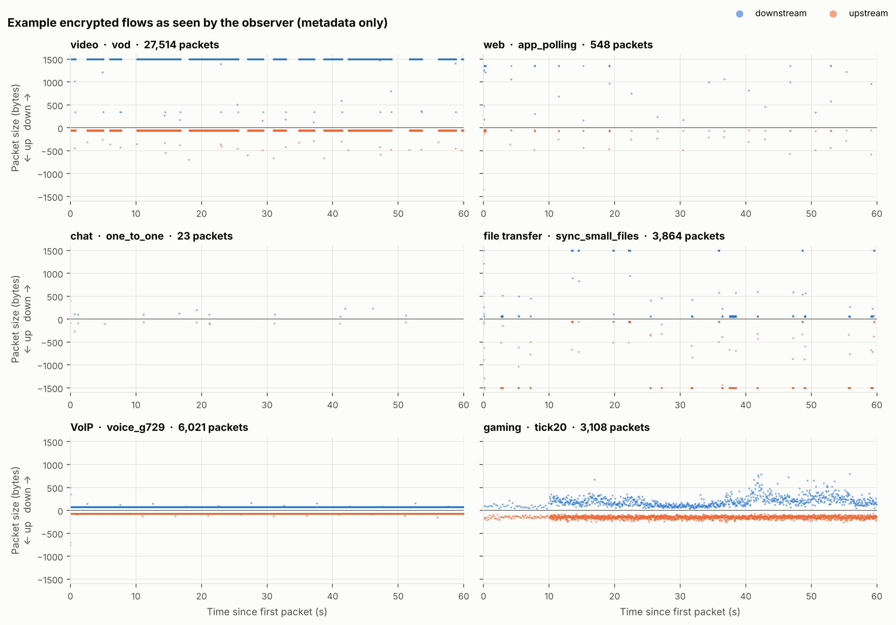
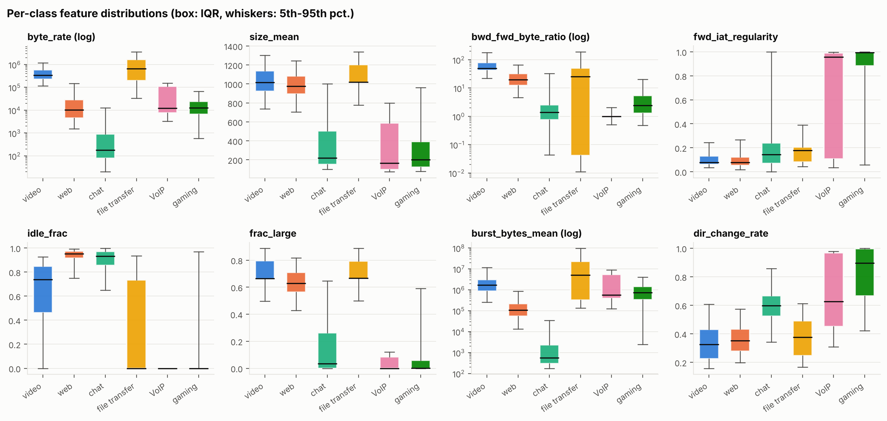
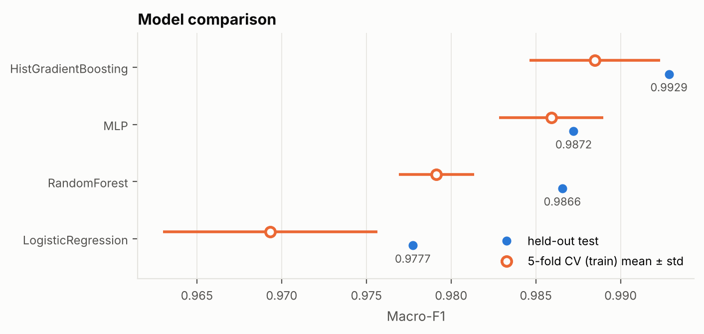
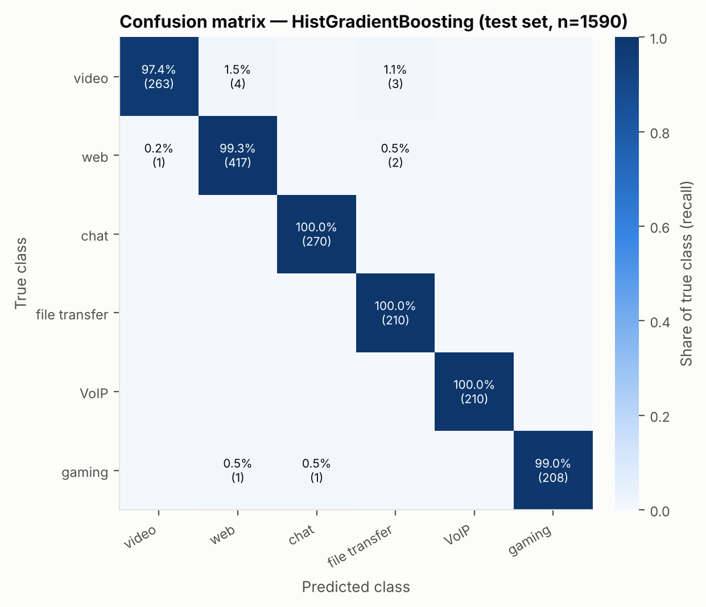
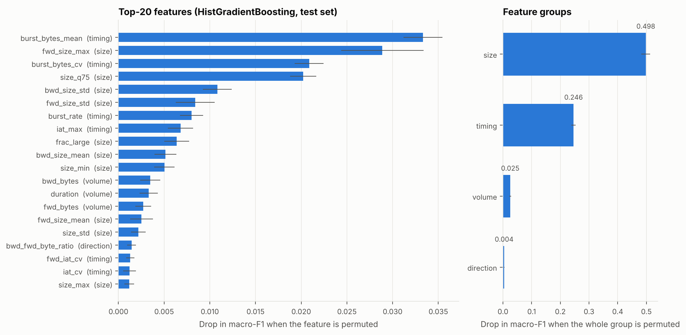
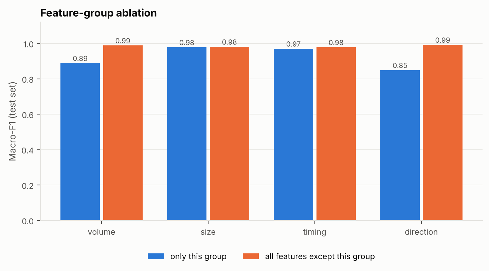
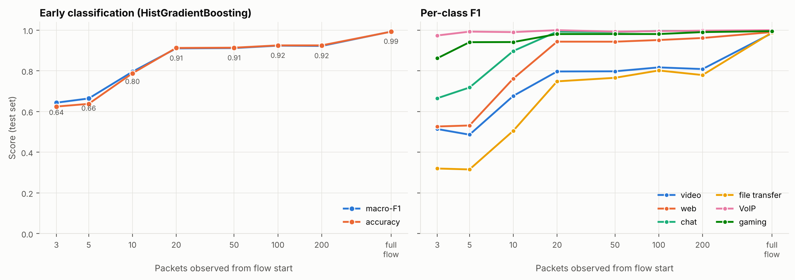
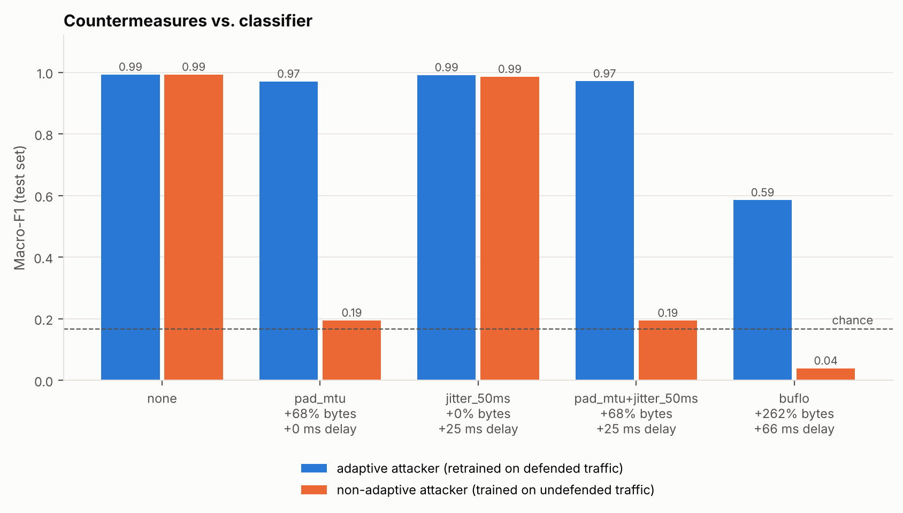

# What Encrypted Flows Still Reveal: Classifying Traffic Type from Packet Sizes, Timing and Direction

*Research mini-project, November 2026. Code, data and every number in this paper are in this repository and reproducible with `python -m src.run_pipeline`.*

---

## Abstract

Almost all Internet traffic is now encrypted with TLS 1.3, QUIC or SRTP, and Encrypted Client Hello and DNS-over-HTTPS are starting to hide even the server name. Yet the *shape* of a flow (how large its packets are, when they are sent, and in which direction) is still visible to any on-path observer. This paper measures how much that metadata reveals about the *type* of application behind a flow, and what it costs to hide it. We build a documented packet-level generator for six traffic classes (video streaming, web browsing, chat, file transfer, VoIP and online gaming). It covers 34 behavioural sub-types and per-flow network conditions, and from it we produce 5,300 labelled flows. From each flow we extract 45 payload-free features in four groups: volume, size, timing and direction. We compare logistic regression, random forest, histogram gradient boosting and a multilayer perceptron. Gradient boosting reaches 99.25% accuracy and 0.993 macro-F1 on 1,590 held-out flows (5-fold CV macro-F1 0.988 ± 0.004). The residual errors fall almost entirely on sub-types that really are ambiguous: short-form and paused video, web pages with embedded video, and casual HTTPS games. Twenty packets are enough for 0.91 macro-F1. Padding every packet to the MTU (+68% bytes) blinds a non-adaptive classifier (0.19 macro-F1) but not one that retrains on padded traffic (0.97). Constant-rate BuFLO-style shaping lowers even the adaptive attacker to 0.59, at +262% bytes and multi-second delays for bulk transfers. A shift from broadband to cellular network conditions costs 2.5 F1 points, and adding cellular examples to training recovers about half of that loss. Because the data is synthetic, we treat the relative findings, not the absolute accuracies, as the transferable result.

---

## 1 Introduction

Network operators have long classified traffic by port number or by deep packet inspection (DPI) of payloads. Both are now largely obsolete. Applications share port 443, and TLS 1.3 [12], QUIC [13] and SRTP [20] encrypt everything above the transport header. Encrypted Client Hello [23] and encrypted DNS remove the last plaintext hint of the destination. Operators still have legitimate reasons to know what kind of traffic they carry: capacity planning, quality-of-service policies, enforcing acceptable-use rules, and noticing when a tunnel that claims to be a video stream behaves like data exfiltration. At the same time, the same capability enables surveillance of user activity.

Encryption hides *content*, not *behaviour*. A video player fetches multi-megabyte segments every few seconds. A VoIP call sends a 100–200-byte packet every 20 ms in both directions. A chat client mostly sleeps. These patterns survive encryption because they come from the application's logic, not from the bytes it sends. A large body of work has shown that statistical flow features [3, 4, 5] and, more recently, deep models on packet sequences [6, 7, 21] can identify applications, websites [10] and even video titles [9] or spoken phrases [8] from encrypted traffic.

This project asks three practical questions with a fully reproducible, self-contained pipeline:

1. **How well** can common, lightweight models identify the traffic *category* of a flow from metadata alone, and which kinds of metadata matter most?
2. **How quickly**: how many packets are needed before the decision is reliable?
3. **How robustly**: what happens when the endpoint pads or shapes its traffic, or when network conditions change?

**Contributions.**

* A documented, packet-level synthetic traffic generator for six classes and 34 recorded sub-types. It models protocol behaviour (DASH segment scheduling, TCP slow start and stretch ACKs, RTP packetisation with voice activity detection, game tick rates) together with per-flow RTT, capacity, jitter and loss (§3.1).
* A 45-feature, payload-free flow representation in four interpretable groups (§3.2), and a comparison of four model families under a CV-based selection protocol (§4.2).
* An error analysis by sub-type, permutation-based group importance and a group ablation, which together show *why* the classifier works and where it fails (§4.3–4.4).
* An early-classification curve (§4.5), an evaluation of four countermeasures against adaptive and non-adaptive attackers with their byte and latency costs (§4.6), and a domain-shift experiment (§4.7).

The rest of the paper covers background (§2), methodology (§3), results (§4), discussion and limitations (§5), and conclusions (§6).

---

## 2 Background

### 2.1 What encryption leaves visible

TLS 1.3 encrypts the handshake after the ServerHello and all application data. QUIC also encrypts most transport-layer metadata. SRTP encrypts media payloads. What remains for a passive observer is the IP and transport header of each packet: addresses, ports, the protocol number, the total length and, implicitly, the capture timestamp. Grouping packets by 5-tuple gives *flows*, and the direction of each packet follows from which endpoint sent it. Record padding is allowed by TLS 1.3 and QUIC, but popular implementations rarely use it, so packet lengths closely track application message sizes.

### 2.2 Traffic classification approaches

*Port-based* classification broke down once applications began to share or randomise ports. *DPI* matches payload signatures and does not work on encrypted payloads. *Statistical, flow-based* classification instead describes each flow by summary statistics of packet sizes and inter-arrival times and trains a supervised model. Moore and Zuev used naïve Bayes over 248 flow discriminators [3], and Nguyen and Armitage surveyed the ML techniques [4]. Draper-Gil et al. showed that time-related features alone separate categories of encrypted and VPN traffic in the ISCX VPN-nonVPN dataset [2]. *Deep-learning* approaches feed raw packet bytes or size/direction sequences to CNNs and RNNs [6, 7, 21], and nPrint argues for standard packet-level representations [27]. They often gain accuracy at the cost of interpretability and compute. We focus on flow-statistic features with classical and shallow neural models because they are cheap enough for flow exporters and easy to interpret.

### 2.3 Flow features

Flow export standards such as NetFlow and IPFIX [14] report packet and byte counts, durations and timestamps for each flow. Research tools such as CICFlowMeter [28] extend this with per-direction size and inter-arrival statistics, burst ("active/idle") measures and flag counts. Bernaille et al. showed that the sizes of the first few packets already identify many applications ("traffic classification on the fly") [5], which motivates *early classification*. Our features (§3.2) follow these traditions and add a periodicity measure suited to real-time media.

### 2.4 Traffic-analysis countermeasures

Defences fall into two broad families. **Padding** hides individual packet lengths. **Shaping**, which includes dummy traffic, constant-rate transmission and delaying, hides timing and volume. Dyer et al. showed that a wide range of *efficient* padding schemes fail against classifiers that use coarse features such as total bytes, burst sizes and duration. Only **BuFLO**, which sends fixed-size packets at a fixed rate for a minimum duration, substantially reduced accuracy, and it did so at a large bandwidth cost [1]. Later designs such as CS-BuFLO [24] and Tamaraw [11] and Walkie-Talkie [25] trade cost against protection. A key methodological point from this literature is to evaluate defences against an **adaptive** attacker that retrains on defended traffic.

### 2.5 Threat model

The **adversary** is a passive on-path observer near the client: an ISP, an enterprise gateway, a Wi-Fi operator or a state-level monitor. For each packet of a bidirectional flow it records the IP length, the timestamp and the direction. It cannot decrypt, does not modify traffic, and aims to label each flow with one of six application categories. We **withhold** IP addresses, ports, DNS, SNI, certificates and the transport protocol number. They often reveal the answer outright, but they are increasingly hidden by ECH, VPNs and tunnels, and withholding them isolates the leakage that survives tunnelling. Flows are observed for at most 60 s, like an IPFIX active timeout. The **defender** is the endpoint or a tunnel, and it may pad or shape traffic (§3.5). This capability is dual-use. Defensively it supports QoS, policy enforcement and detection of tunnels that do not behave like the application they claim to be. Offensively it supports profiling of users' activities. We therefore report the defender's options alongside the attacker's success.

---

## 3 Methodology

### 3.1 Synthetic packet-level traffic generator

We generate traffic synthetically for two reasons. Public encrypted-traffic corpora (e.g. ISCX VPN-nonVPN [2]) are large pcap collections behind registration forms that a script cannot reliably download. Our experiments also need *packet traces*, not just feature vectors: early classification and countermeasures must transform the packets *before* features are computed. The generator (`src/traffic_generator.py`) emits, for each flow, a time-ordered sequence of `(timestamp, IP length, direction)` tuples as observed at a gateway next to the client. Upstream packets therefore keep the sender's own timing, and downstream packets carry network jitter.

**Network model.** Each flow draws its own conditions:

* RTT: lognormal with a median of 35 ms.
* Downlink capacity: lognormal with a median of 30 Mbit/s; uplink is about 25% of downlink.
* Jitter, and a per-packet probability of a loss-recovery stall lasting 1–2 RTT.
* A receiver ACK ratio drawn from {1, 2, 3, 4, 8}. This models delayed ACKs and GRO "stretch" ACKs.

Bulk transfers model TCP slow start (windows doubling once per RTT until the bandwidth-delay product is reached) followed by gamma-distributed spacing at the target rate. Encrypted connections start with a TCP + TLS 1.3 handshake (ClientHello of 517–660 B and a 2.5–6 kB certificate flight) or a QUIC handshake (Initial padded to 1,252/1,350 B). QUIC flows use an implementation-dependent maximum packet size of 1,252–1,452 B. Long-lived flows are often *already running* when observation starts (no handshake visible) and have a lognormal remaining session length, so every class contains short flows.

**Classes and sub-types.** The behaviours below are summarised from the code. Sub-type shares are given in parentheses, and the README contains the full table.

* **Video** (900 flows). DASH/HLS-style adaptive streaming [19]: buffering of 2–7 segments, then one segment every 2–10 s at a lognormal bitrate (median 2.5 Mbit/s), with an optional separate audio track. Sub-types: *VoD*; *live* (20%, 1–2 s segments); *paused* (15% of VoD, only telemetry keep-alives while paused); *short-form* feeds (20%, 0.2–8 MB clips fetched at heavy-tailed swipe intervals).
* **Web** (1,400 flows). Page loads of 1+Poisson(6) objects with lognormal sizes (median 8 kB, σ = 1.4) and about 8 s of think time between pages, followed by a keep-alive idle period and close. Sub-types: *standard*; *media-heavy* (15%); *app polling* (15%, a single-page app polling an API every 2–20 s); *embedded video* (8%, an auto-playing clip).
* **Chat** (900 flows). A persistent connection observed mid-stream 60% of the time. Active periods (exp. 25 s) alternate with idle periods (exp. 40 s). The flow carries messages of 90–1,400 B with app-level ACKs, typing indicators, read receipts, heartbeats every 10–45 s, presence pushes, and attachments on 4% of messages (median 120 kB). Sub-types: *one-to-one* and *group*.
* **File transfer** (700 flows). A saturating bulk download or upload (30% uploads) of a lognormal file size (median 15 MB). Sub-types: *throttled* (20%, a token bucket producing periodic bursts) and *small-file sync* (20%, many small transfers separated by idle gaps).
* **VoIP** (700 flows). RTP/SRTP [20] with one of five codecs (60–214 B packets every 20 or 40 ms in both directions). With voice activity detection on, talk spurts alternate with silence and a SID packet is sent every 400 ms during silence; the speaker balance differs per call. RTCP reports go out every 5 s. Sub-type *video call* (30%) adds 15–30 fps video frames with periodic keyframes.
* **Gaming** (700 flows). The client sends small inputs at a 20–128 Hz tick rate; the server sends activity-modulated snapshots (median about 220 B). Matches alternate with lobby phases, and 15% of flows include an asset download. Sub-types: *peer-to-peer* (20%, symmetric) and *casual TLS* (15%, turn-based HTTPS request/response).

Every class has its own seed stream derived from a master seed with NumPy's `SeedSequence`, so the dataset is bit-identical across runs and machines. We generate 5,300 broadband flows. For the domain-shift experiment we generate two further disjoint sets of 1,200 flows each (200 per class) under a **cellular** profile: RTT 110 ms, 6 Mbit/s, about 6× the jitter and about 7× the loss.

### 3.2 Feature extraction

Each flow is summarised by 45 features (`src/features.py`) computed only from sizes, timestamps and directions. Table 1 lists them.

**Table 1 – Feature groups.**

| Group | # | Features |
|---|---|---|
| Volume | 9 | packets; bytes (total, upstream, downstream); upstream/downstream packets; duration; packet rate; byte rate |
| Size | 15 | mean, std, min, max, 25/50/75th percentile of packet size; per-direction mean, std, max; fraction ≤ 128 B; fraction ≥ 1,200 B |
| Timing | 18 | inter-arrival mean, std, CV, median, max, *regularity*; the same (mean, std, CV, regularity) per direction; bursts/s (gap > 0.5 s); mean and CV of burst bytes; idle fraction (gaps > 1 s) |
| Direction | 3 | downstream/upstream byte ratio; downstream packet fraction; direction-change rate |

*Regularity* is the share of inter-arrival times within ±15% of the median inter-arrival time. It is close to 1 for constant-rate senders such as VoIP codecs and game ticks, and low for bursty traffic.

### 3.3 Models

We compare four scikit-learn [15] models. Their hyper-parameters are fixed in advance and none are tuned on the test set.

* **Logistic regression (LR):** multinomial, C = 1, applied to `log1p`-transformed and standardised features (flow statistics are heavy-tailed and non-negative).
* **Random forest (RF)** [16]: 300 trees, √d features per split.
* **Histogram gradient boosting (HGB)** [17, 18]: 300 iterations, learning rate 0.08, 31 leaves, L2 regularisation 10⁻³.
* **Multilayer perceptron (MLP):** two hidden layers of 128 and 64 ReLU units, α = 10⁻³, Adam with early stopping, on `log1p`-standardised features.

### 3.4 Evaluation protocol

We split the 5,300 flows into a stratified 70/30 train/test split (3,710 / 1,590 flows). On the training part we run stratified 5-fold cross-validation. **The best model is selected by mean CV macro-F1**, and the test set is used only for reporting. Because the classes are unbalanced (web is 26% of flows), we report accuracy and *macro-averaged* precision, recall and F1 as the primary metrics, plus weighted F1, per-class metrics and confusion matrices. The same flow-level split is reused for every derived view (prefixes, defended traffic), so all comparisons are paired.

### 3.5 Additional experiments

* **Feature importance.** Permutation importance [16, 26] of the selected model on the test set, measured as the drop in macro-F1 over 10 repeats. We also permute each *group* jointly (one shared row permutation for all of a group's columns), which avoids the dilution that correlated features cause in single-feature importance.
* **Group ablation.** The selected model is retrained on each group alone, and on all features except that group.
* **Early classification.** Features are computed from only the first *N* ∈ {3, 5, 10, 20, 50, 100, 200} packets of each flow; the model is retrained and re-tested for each *N*.
* **Countermeasures** (`src/defenses.py`), applied to the packet traces:
  * *pad_mtu*: every packet is padded to 1,500 B.
  * *jitter_50ms*: each packet is delayed by an independent U(0, 50 ms) amount.
  * *pad_mtu + jitter_50ms*: both of the above.
  * *BuFLO* [1]: in each direction an MTU-sized cell is sent every ρ = 5 ms (2.4 Mbit/s), carrying real data when queued and dummy data otherwise, for at least τ = 10 s and until the queue drains. Real packets leave a FIFO queue at `dep_i = max(arr_i, dep_{i−1} + ρ)` rounded up to the cell grid.

  The *adaptive* attacker retrains on defended training flows; the *non-adaptive* attacker keeps the model trained on undefended traffic. We report byte overhead within the observation window and the median per-flow mean queueing delay.
* **Domain shift.** The broadband-trained model is tested on the cellular test set. We then retrain on broadband plus the 1,200 cellular training flows and test on both test sets.

### 3.6 Implementation and reproducibility

The whole study runs with `python -m src.run_pipeline` in about 3 minutes on 4 CPU cores. It uses only NumPy, pandas, scikit-learn and Matplotlib. We verified reproducibility by deleting all data and results and re-running in a fresh virtual environment with different minor versions of NumPy and pandas: every metric matched to the last digit. Doing so required reading the CSV feature files with exact round-trip float parsing, because the older pandas default parser can differ by one ulp, which is enough to move a gradient-boosting split threshold. Nine unit tests cover the feature values, the validity and determinism of generated traces, the invariants of each defence, and learnability.

---

## 4 Experiments and Results

### 4.1 Dataset

**Table 2 – Dataset summary (broadband, 5,300 flows; medians per flow).**

| Class | Flows | Packets | Duration (s) | Bytes |
|---|---|---|---|---|
| video | 900 | 17,061 | 57.6 | 17.1 MB |
| web | 1,400 | 330 | 36.8 | 318 kB |
| chat | 900 | 39 | 52.5 | 9.1 kB |
| file transfer | 700 | 7,336 | 29.0 | 7.9 MB |
| VoIP | 700 | 6,011 | 60.0 | 574 kB |
| gaming | 700 | 4,706 | 60.0 | 760 kB |

Figure 1 shows one generated flow per class as the observer sees it. Video shows periodic bursts of full-size downstream packets. VoIP shows two flat constant-size bands. Chat is a handful of small packets spread over a minute. Figure 2 shows per-class distributions of eight features: no single feature separates all six classes, but each pair of classes differs in at least one.

*Figure 1 – One example flow per class: packet size over time, downstream above the axis and upstream below.*

*Figure 2 – Per-class feature distributions (box: inter-quartile range; whiskers: 5th–95th percentile).*

### 4.2 Model comparison

**Table 3 – Test-set results (1,590 flows) and 5-fold CV on the training set.** Inference time is per flow in batch mode; training time is for the 3,710 training flows (4 cores). Timings are wall-clock measurements and vary by a few tens of percent between runs; they are the only non-deterministic values in `results/`.

| Model | Accuracy | Precision (macro) | Recall (macro) | F1 (macro) | F1 (weighted) | CV F1 (macro) | Train (s) | Predict (µs/flow) |
|---|---|---|---|---|---|---|---|---|
| Logistic regression | 0.9761 | 0.9784 | 0.9771 | 0.9777 | 0.9761 | 0.9693 ± 0.0063 | 0.8 | 5.0 |
| Random forest | 0.9855 | 0.9865 | 0.9867 | 0.9866 | 0.9855 | 0.9791 ± 0.0022 | 1.4 | 84.0 |
| **Hist. gradient boosting** | **0.9925** | **0.9929** | **0.9929** | **0.9929** | **0.9924** | **0.9885 ± 0.0038** | 2.9 | 44.1 |
| MLP | 0.9862 | 0.9869 | 0.9877 | 0.9872 | 0.9862 | 0.9859 ± 0.0031 | 1.6 | 3.2 |

All four models exceed 0.97 macro-F1, so even a linear model on log-scaled flow statistics captures most of the class structure. HGB has the best CV score, so it is the selected model, and it also has the best test score. It makes 12 errors out of 1,590 flows, against 38 for LR. Test scores are slightly above the CV means for every model, because the final models are trained on all 3,710 training flows rather than 4/5 of them. The ranking is the same under CV and on the test set except that RF and MLP swap places, and their CV intervals overlap (Figure 3).

*Figure 3 – Macro-F1 per model: held-out test (filled) and 5-fold CV mean ± std on the training set (hollow).*

Figure 4 shows the confusion matrix of HGB. Chat, file transfer and VoIP are recalled perfectly. The errors concentrate on **video** (7 of 270 misclassified: 4 as web, 3 as file transfer), **web** (3 of 420: 2 as file transfer, 1 as video) and **gaming** (2 of 210: 1 as web, 1 as chat). File transfer has the lowest precision (0.977), because it absorbs bulk-looking video and web flows. LR makes the same kinds of mistakes more often: 10 web flows as video, 7 gaming flows as web, and 6 video flows as web (`results/confusion_matrix_LogisticRegression.csv`).

*Figure 4 – Confusion matrix of the selected model (HGB) on the test set; rows are normalised to recall.*

### 4.3 Error analysis by sub-type

Because the generator records each flow's sub-type, we can see *which behaviours* cause the errors (`results/errors_by_subtype.csv`). Every one of HGB's 12 errors falls in a sub-type that was designed to resemble another class:

* **Video:** *short-form* 51/54 correct (94.4%), *paused* 18/19, *live* 45/47, against 149/150 for regular VoD. Short-form clips are large, aperiodic downloads, which is how web pages and file transfers look. A paused player emits only sparse telemetry. Live streams with 1–2 s segments are nearly continuous, which is how a throttled download looks.
* **Web:** *embedded video* 27/29 (93.1%) and *media-heavy* 54/55, against 276/276 for standard pages and 60/60 for app polling.
* **Gaming:** *casual TLS* 23/25 (92.0%). These are turn-based games that use HTTPS request/response and genuinely look like web or chat traffic. All 185 real-time gaming flows are correct.

In other words, the classifier recovers the *traffic behaviour* almost perfectly, and its mistakes are cases where the behaviour of one class mimics another. Such flows would also be ambiguous to a human analyst who only had the metadata.

### 4.4 Which metadata matters?

*Figure 5 – Permutation importance (drop in test macro-F1) for the top-20 individual features (left) and for whole feature groups (right) of the HGB model.*

**Group importance.** When a whole group is permuted, macro-F1 drops by **0.498 ± 0.016 for size**, **0.246 ± 0.007 for timing**, 0.025 ± 0.003 for volume and 0.004 ± 0.001 for direction (Figure 5, right). The model therefore relies mainly on packet-size and timing structure.

**Individual features.** The most important individual features are the mean burst size (`burst_bytes_mean`, 0.033), the largest upstream packet (`fwd_size_max`, 0.029), the variability of burst sizes (`burst_bytes_cv`, 0.021), the 75th percentile of packet size (0.020) and the standard deviation of downstream sizes (0.011). They are mostly small because the features are highly redundant: permuting a single feature rarely hurts when correlated features carry the same information. The RF's impurity-based ranking is similar and puts more weight on timing variability (`iat_std` 0.051, `burst_bytes_cv` 0.050, `frac_large` 0.046, `fwd_iat_std` 0.045).

**Ablation.** The ablation (Figure 6) confirms the redundancy and adds nuance:

| Group | Only this group (macro-F1) | All but this group (macro-F1) |
|---|---|---|
| volume (9) | 0.888 | 0.989 |
| size (15) | 0.978 | 0.981 |
| timing (18) | 0.970 | 0.978 |
| direction (3) | 0.849 | 0.992 |

Size features alone (0.978) or timing features alone (0.970) come within 1.5–2.3 points of the full model (0.993). Removing either one costs about 1–1.5 points, because the other group partly compensates. The three direction features alone already reach 0.849, which shows how informative up/down asymmetry is: VoIP is symmetric, file transfers and video are extremely asymmetric, and chat sits in between. However, they add nothing once the other groups are present (0.992 without them). The small permutation importance of volume and direction thus reflects *redundancy*, not *irrelevance*. This matters for defences: a countermeasure must hide *every* group that independently identifies the class.

*Figure 6 – Feature-group ablation: macro-F1 of HGB trained on one group only and on all groups except one.*

### 4.5 Early classification

**Table 4 – Macro-F1 (and accuracy) from the first N packets.**

| N packets | 3 | 5 | 10 | 20 | 50 | 100 | 200 | full flow (≤ 60 s) |
|---|---|---|---|---|---|---|---|---|
| Macro-F1 | 0.644 | 0.664 | 0.796 | 0.910 | 0.912 | 0.924 | 0.922 | 0.993 |
| Accuracy | 0.625 | 0.638 | 0.788 | 0.913 | 0.914 | 0.925 | 0.925 | 0.992 |

*Figure 7 – Early classification: overall scores (left) and per-class F1 (right) as a function of the number of observed packets.*

Accuracy rises steeply between 5 and 20 packets and then *plateaus* at about 0.91–0.92 until 200 packets. It reaches 0.99 only with the full observation window (Table 4, Figure 7). The per-class curves explain the pattern:

* **VoIP and gaming** are recognised almost immediately (F1 0.97 and 0.86 at 3 packets; 1.00 and 0.98 at 20). Their first packets are not a TLS handshake but STUN/RTP or game datagrams of characteristic sizes and spacing.
* **Chat** reaches 0.99 by 20 packets, because its small packets and long gaps show up early.
* **Web, video and file transfer** all begin with the same TCP/TLS or QUIC handshake. At 3–5 packets they are near-indistinguishable (F1 0.32–0.53), and even at 200 packets video (0.81) and file transfer (0.78) are still confused. Two hundred packets of a 2.5 Mbit/s stream span less than a second, so they cannot show the *seconds-scale* ON/OFF segment periodicity that separates adaptive streaming from a bulk download. Only the full window exposes it.

The practical consequence is that the *number* of packets is the wrong budget for early classification of bulk classes; the *time span* observed matters more. For operators, 20 packets suffice to separate real-time media and chat from bulk traffic, which is the distinction most QoS policies need.

### 4.6 Countermeasures

**Table 5 – Effect of countermeasures (test set).** Overhead is measured over the test flows within the 60-s window. Delay is the median over flows of the mean added per-packet delay.

| Defence | Byte overhead | Median delay | Macro-F1, adaptive | Macro-F1, non-adaptive |
|---|---|---|---|---|
| none | 0% | 0 ms | 0.993 | 0.993 |
| pad_mtu | +68% | 0 ms | 0.970 | 0.195 |
| jitter_50ms | 0% | 25 ms | 0.991 | 0.986 |
| pad_mtu + jitter_50ms | +68% | 25 ms | 0.971 | 0.194 |
| BuFLO (ρ = 5 ms, τ = 10 s) | +262% | 66 ms | 0.585 | 0.039 |

*Figure 8 – Macro-F1 of adaptive and non-adaptive attackers under each countermeasure, with the countermeasure's byte and delay costs.*

**Padding alone is security theatre against an adaptive attacker.** Padding every packet to the MTU completely fools the stale, non-adaptive model (0.195 macro-F1, around chance level of 0.167). Once the attacker retrains on padded traffic, macro-F1 is back to **0.970**. This matches the ablation: timing (0.970 alone) and volume/direction still identify the class. It also reproduces at the category level what Dyer et al. found for website fingerprinting [1].

**Small random delays do not help.** Jitter of up to 50 ms leaves macro-F1 at 0.991 (adaptive) and 0.986 (non-adaptive). The informative timing structure (2–10 s video segments, idle periods, 20–40 ms codec intervals measured *on average*) lives at timescales or statistics that zero-mean noise barely changes.

**Constant-rate shaping works, at a high cost.** BuFLO turns each flow into two identical 2.4 Mbit/s cell streams whose only free parameter is their length. The adaptive attacker falls to **0.585** macro-F1 (accuracy 0.606), and the non-adaptive model collapses to 0.039 because it predicts almost everything as a single class. The residual signal is flow duration, which still reveals sessions that end early and transfers that overrun the τ = 10 s minimum. The cost is very unevenly distributed (Table 6, `results/defenses_cost_per_class.csv`).

**Table 6 – Cost of each defence per class (test flows).**

| Class | pad_mtu bytes | BuFLO bytes | BuFLO median delay | BuFLO p90 delay |
|---|---|---|---|---|
| video | +54% | +40% | 5.9 s | 42.8 s |
| web | +51% | +2,558% | 98 ms | 1.07 s |
| chat | +88% | +27,821% | 2.9 ms | 205 ms |
| file transfer | +41% | +2% | 5.4 s | 69.9 s |
| VoIP | +259% | +1,085% | 3.3 ms | 8.7 ms |
| gaming | +535% | +2,593% | 2.6 ms | 66 ms |

Low-rate classes pay enormous *byte* overheads. A chat flow that normally sends about 9 kB now sends 2.4 Mbit/s of cover traffic for at least 10 s, which is about 280 times its original volume. High-rate classes pay in *latency*: video and bulk transfers above the 2.4 Mbit/s cell rate are throttled, so their packets queue for seconds (p90 of 43–70 s). This makes adaptive streaming at normal bitrates impossible. The byte overhead for video and file transfer looks small only because queued data that would be sent after the 60-s observation window is not counted. Even padding to the MTU multiplies the bandwidth of real-time classes by 3.6–6.3, because their packets are small. No single fixed-rate configuration is both cheap and protective across all six classes, which is the central tension identified by the defence literature [1, 11].

### 4.7 Domain shift

**Table 7 – Train on one network profile, test on another (HGB).**

| Training data | Test data | Accuracy | Macro-F1 |
|---|---|---|---|
| broadband | broadband | 0.9925 | 0.9929 |
| broadband | cellular | 0.9683 | 0.9684 |
| broadband + cellular | cellular | 0.9817 | 0.9817 |
| broadband + cellular | broadband | 0.9918 | 0.9922 |

When the broadband-trained model meets cellular conditions (3× RTT, a fifth of the capacity, more jitter and loss), macro-F1 drops by **2.5 points** to 0.968. The drop is concentrated in the bulk classes: video F1 0.937 (recall 0.925), file transfer 0.947 (recall 0.930), web 0.943 (precision 0.904). VoIP (1.000), chat (0.998) and gaming (0.987) are unaffected. This is expected. Lower capacity stretches bursts and blurs the distinction between "fast bulk transfer" and "paced segment download". Real-time media is application-paced, so it does not depend on the network. Adding 1,200 cellular flows to training recovers macro-F1 to 0.982 on cellular traffic without hurting broadband (0.992). Network diversity in training data therefore matters more than model choice, since the model-to-model spread on the in-distribution test was about 1.5 points.

---

## 5 Discussion and Limitations

**What the high accuracy does and does not mean.** In our generator the six categories are separable at 99% from metadata alone. This confirms that, *under the modelled behaviours*, application logic leaves a strong, redundant fingerprint in sizes, timing and direction. It does **not** imply that a deployed classifier would reach 99% on real traffic. Real networks add effects we do not model: multiplexed connections (HTTP/2 coalescing, a browser sharing a QUIC connection between a video and a page), middleboxes and offloads (TSO/GRO coalescing, proxies), app-specific quirks, background traffic inside VPN tunnels, and label noise in ground truth. Published results on real encrypted datasets with comparable category granularity range from the mid-80s to high-90s percent depending on dataset and protocol [2, 6, 21]. Our numbers sit at the optimistic end of that range, as one would expect for clean, generated labels.

**Transferable findings.** The *relative* results come from structural properties of the protocols rather than from tuning, so we expect them to transfer:

1. Size and timing are each sufficient on their own and largely redundant with each other, and direction alone is surprisingly strong. Defences must therefore cover all of them.
2. Real-time media is identifiable within a handful of packets, while bulk classes need seconds of observation.
3. Padding without shaping does not stop an adaptive attacker. Constant-rate shaping does, but its cost is strongly class-dependent.
4. Changes in network conditions mainly hurt the bulk classes and are best mitigated through diverse training data.

**Implications.** For *operators*, a small gradient-boosted model on 45 flow statistics classifies a flow in tens of microseconds (Table 3), which is cheap enough for flow exporters. A 20-packet prefix already supports QoS decisions between real-time and bulk traffic. For *privacy engineers*, protection needs shaping that adapts per application, such as CS-BuFLO/Tamaraw-style adaptive rates [11, 24] or application-aware shaping [25], rather than per-packet padding. For *researchers*, a packet-level generator lets defences and early classification be studied on exactly the same flows, which feature-level synthetic data cannot do.

**Limitations.**

* **Synthetic data.** The generator encodes our understanding of each protocol. A classifier can only learn what the generator puts in, and behaviours we did not model may be confused in ways we cannot see. We mitigated this with 34 sub-types designed to overlap across classes, per-flow network conditions, mid-stream observation and natural session ends, but it is not a substitute for validation on captured traffic.
* **Closed world.** Every flow belongs to one of six known classes. Real deployments face unknown and mixed applications, which is the open-world problem highlighted for ML-based network security by Sommer and Paxson [22].
* **One application per flow.** We classify individual flows. Tunnels (VPN, Tor) that multiplex several applications into one flow would require separating the mixture first.
* **Withheld side channels.** Excluding ports, SNI and protocol numbers is deliberate (see the threat model), but it means our accuracy is a *lower bound* on what an observer with full headers can achieve today.
* **Fixed observation window and vantage point.** The 60-s window and the client-side vantage point shape the timing features. A vantage point near the server or a longer window would shift the early-classification curve.
* **Defence cost accounting.** BuFLO's byte overhead is measured inside the observation window. Queued data beyond it is not counted, so the overhead for high-rate classes is underestimated, and we model a single parameter setting rather than the full cost/protection frontier.
* **Statistical uncertainty.** We report the CV standard deviation (0.002–0.006 macro-F1) and a single fixed test split. Differences smaller than about 0.005 between models should not be over-interpreted.

**Ethics.** Traffic classification is dual-use. All data here is synthetic and contains no personal information. We publish the countermeasure results alongside the attack so that defenders can make informed decisions about cost and protection.

---

## 6 Conclusion

We built a reproducible pipeline (packet-level generator, 45 metadata features, four models and five experiments) to quantify how much encrypted flows reveal about their application type. Under our threat model, a gradient-boosted classifier identifies six traffic categories with 99.25% accuracy and 0.993 macro-F1, and its remaining errors fall on behaviours that truly mimic another category. Packet-size and timing features each nearly suffice alone. Twenty packets give 0.91 macro-F1, and real-time media is recognised almost instantly. Padding to the MTU costs 68% more bytes yet leaves an adaptive attacker at 0.97 macro-F1. Only constant-rate shaping substantially reduces accuracy (0.59), at costs ranging from 278× the bytes for chat to multi-second delays for video. A change of network conditions costs about 2.5 F1 points, and about half of that is recovered by adding cellular examples to training. Encryption protects what we say but not, by itself, what we are doing.

Future work: validate the generator's sub-types against captured traces; add multiplexed and tunnelled flows and an open-world "unknown" class; compare against sequence models on the raw (size, direction, time) series; and explore adaptive shaping that bounds overhead for each class.

---

## References

[1] K. P. Dyer, S. E. Coull, T. Ristenpart, T. Shrimpton. "Peek-a-Boo, I Still See You: Why Efficient Traffic Analysis Countermeasures Fail." *IEEE Symposium on Security and Privacy*, 2012.

[2] G. Draper-Gil, A. H. Lashkari, M. S. I. Mamun, A. A. Ghorbani. "Characterization of Encrypted and VPN Traffic Using Time-Related Features." *Proc. ICISSP*, 2016.

[3] A. W. Moore, D. Zuev. "Internet Traffic Classification Using Bayesian Analysis Techniques." *ACM SIGMETRICS*, 2005.

[4] T. T. T. Nguyen, G. Armitage. "A Survey of Techniques for Internet Traffic Classification Using Machine Learning." *IEEE Communications Surveys & Tutorials*, 10(4), 2008.

[5] L. Bernaille, R. Teixeira, I. Akodkenou, A. Soule, K. Salamatian. "Traffic Classification on the Fly." *ACM SIGCOMM Computer Communication Review*, 36(2), 2006.

[6] S. Rezaei, X. Liu. "Deep Learning for Encrypted Traffic Classification: An Overview." *IEEE Communications Magazine*, 57(5), 2019.

[7] M. Lotfollahi, M. Jafari Siavoshani, R. Shirali Hossein Zade, M. Saberian. "Deep Packet: A Novel Approach for Encrypted Traffic Classification Using Deep Learning." *Soft Computing*, 24, 2020.

[8] C. V. Wright, L. Ballard, S. E. Coull, F. Monrose, G. M. Masson. "Spot Me if You Can: Uncovering Spoken Phrases in Encrypted VoIP Conversations." *IEEE Symposium on Security and Privacy*, 2008.

[9] R. Schuster, V. Shmatikov, E. Tromer. "Beauty and the Burst: Remote Identification of Encrypted Video Streams." *USENIX Security Symposium*, 2017.

[10] P. Sirinam, M. Imani, M. Juarez, M. Wright. "Deep Fingerprinting: Undermining Website Fingerprinting Defenses with Deep Learning." *ACM CCS*, 2018.

[11] X. Cai, R. Nithyanand, T. Wang, R. Johnson, I. Goldberg. "A Systematic Approach to Developing and Evaluating Website Fingerprinting Defenses." *ACM CCS*, 2014.

[12] E. Rescorla. "The Transport Layer Security (TLS) Protocol Version 1.3." *RFC 8446*, IETF, 2018.

[13] J. Iyengar, M. Thomson (Eds.). "QUIC: A UDP-Based Multiplexed and Secure Transport." *RFC 9000*, IETF, 2021.

[14] B. Claise, B. Trammell, P. Aitken (Eds.). "Specification of the IP Flow Information Export (IPFIX) Protocol for the Exchange of Flow Information." *RFC 7011*, IETF, 2013.

[15] F. Pedregosa et al. "Scikit-learn: Machine Learning in Python." *Journal of Machine Learning Research*, 12, 2011.

[16] L. Breiman. "Random Forests." *Machine Learning*, 45(1), 2001.

[17] J. H. Friedman. "Greedy Function Approximation: A Gradient Boosting Machine." *Annals of Statistics*, 29(5), 2001.

[18] G. Ke, Q. Meng, T. Finley, T. Wang, W. Chen, W. Ma, Q. Ye, T.-Y. Liu. "LightGBM: A Highly Efficient Gradient Boosting Decision Tree." *NeurIPS*, 2017.

[19] I. Sodagar. "The MPEG-DASH Standard for Multimedia Streaming Over the Internet." *IEEE MultiMedia*, 18(4), 2011.

[20] H. Schulzrinne, S. Casner, R. Frederick, V. Jacobson. "RTP: A Transport Protocol for Real-Time Applications." *RFC 3550*, IETF, 2003.

[21] G. Aceto, D. Ciuonzo, A. Montieri, A. Pescapè. "Mobile Encrypted Traffic Classification Using Deep Learning: Experimental Evaluation, Lessons Learned, and Challenges." *IEEE Transactions on Network and Service Management*, 16(2), 2019.

[22] R. Sommer, V. Paxson. "Outside the Closed World: On Using Machine Learning for Network Intrusion Detection." *IEEE Symposium on Security and Privacy*, 2010.

[23] E. Rescorla, K. Oku, N. Sullivan, C. A. Wood. "TLS Encrypted Client Hello." IETF Internet-Draft *draft-ietf-tls-esni*.

[24] X. Cai, R. Nithyanand, R. Johnson. "CS-BuFLO: A Congestion Sensitive Website Fingerprinting Defense." *ACM Workshop on Privacy in the Electronic Society (WPES)*, 2014.

[25] T. Wang, I. Goldberg. "Walkie-Talkie: An Efficient Defense Against Passive Website Fingerprinting Attacks." *USENIX Security Symposium*, 2017.

[26] A. Altmann, L. Toloşi, O. Sander, T. Lengauer. "Permutation Importance: A Corrected Feature Importance Measure." *Bioinformatics*, 26(10), 2010.

[27] J. Holland, P. Schmitt, N. Feamster, P. Mittal. "New Directions in Automated Traffic Analysis." *ACM CCS*, 2021.

[28] A. H. Lashkari, G. Draper-Gil, M. S. I. Mamun, A. A. Ghorbani. "Characterization of Tor Traffic Using Time Based Features." *Proc. ICISSP*, 2017.
